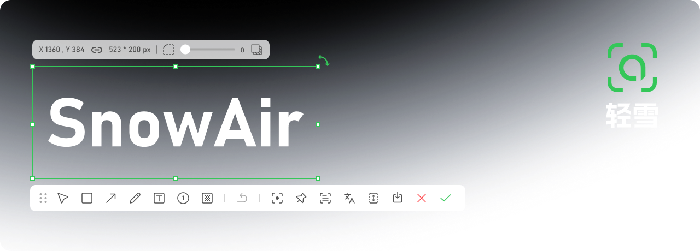
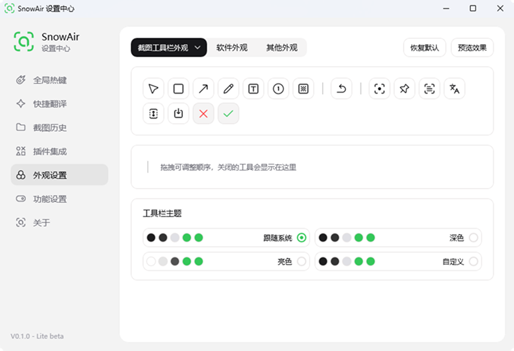
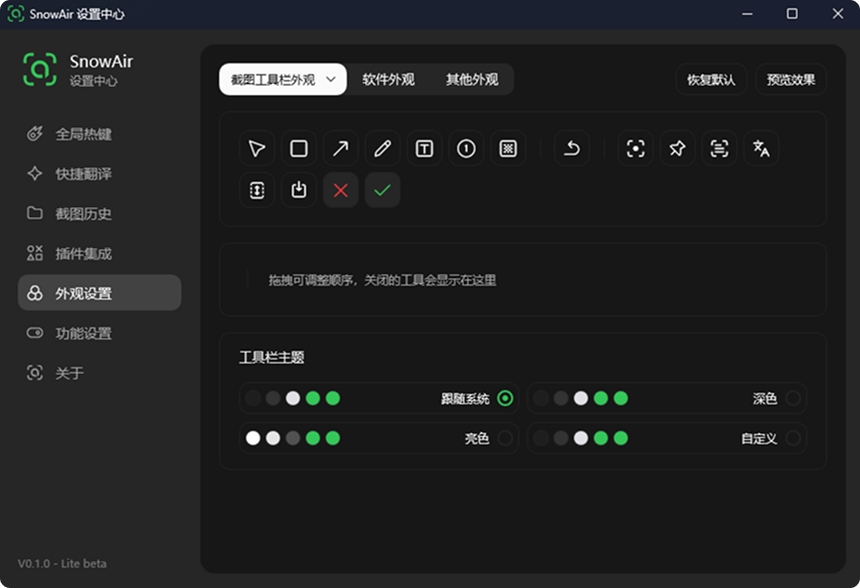

<p align="center">
  <picture>
    <source media="(prefers-color-scheme: light)" srcset="./images/banner.png" />
    
  </picture>
</p>
<h1 align="center">
  <span>SnowAir</span>
</h1>
<p align="center">
  <span align="center">SnowAir is a lightweight Windows screenshot and annotation tool covering screenshots, scrolling capture, screen recording, OCR, annotation, and pinning, available as a free open-source edition and a more complete professional edition.</span>
</p>
<h3 align="center">
  <a href="#-editions">Editions</a>
  <span> · </span>
  <a href="#-installation">Installation</a>
  <span> · </span>
  <a href="Native/ARCHITECTURE.md">Architecture</a>
  <span> · </span>
  <a href="https://github.com/CM-idea/SnowAir/releases">Release Notes</a>
</h3>
<p align="center">
  <a href="README.md">简体中文</a>
  <span> | </span>
  <span>English</span>
</p>

## 🔨 Features

From region capture, screen recording, and presentation canvas to pinning, scrolling capture, and text recognition, SnowAir ships an entire toolkit for everyday screenshots:

|   |   |   |
| --- | --- | --- |
| <picture><source media="(prefers-color-scheme: light)" srcset="images/icon/region.svg" /></picture>&nbsp;&nbsp; Region Capture | <picture><source media="(prefers-color-scheme: light)" srcset="images/icon/record.svg" /></picture>&nbsp;&nbsp; Screen Recording | <picture><source media="(prefers-color-scheme: light)" srcset="images/icon/canvas.svg" /></picture>&nbsp;&nbsp; Presentation Canvas |
| <picture><source media="(prefers-color-scheme: light)" srcset="images/icon/pin.svg" /></picture>&nbsp;&nbsp; Pin | <picture><source media="(prefers-color-scheme: light)" srcset="images/icon/mirror.svg" /></picture>&nbsp;&nbsp; Screen Mirror* | <picture><source media="(prefers-color-scheme: light)" srcset="images/icon/action.svg" /></picture>&nbsp;&nbsp; Super Action* |
| <picture><source media="(prefers-color-scheme: light)" srcset="images/icon/long.svg" /></picture>&nbsp;&nbsp; Scrolling Capture | <picture><source media="(prefers-color-scheme: light)" srcset="images/icon/ocr.svg" /></picture>&nbsp;&nbsp; OCR | <picture><source media="(prefers-color-scheme: light)" srcset="images/icon/translate.svg" /></picture>&nbsp;&nbsp; Translate |
| <picture><source media="(prefers-color-scheme: light)" srcset="images/icon/rect.svg" /></picture>&nbsp;&nbsp; Rectangle | <picture><source media="(prefers-color-scheme: light)" srcset="images/icon/arrow.svg" /></picture>&nbsp;&nbsp; Arrow | <picture><source media="(prefers-color-scheme: light)" srcset="images/icon/pen.svg" /></picture>&nbsp;&nbsp; Pen |
| <picture><source media="(prefers-color-scheme: light)" srcset="images/icon/text.svg" /></picture>&nbsp;&nbsp; Text | <picture><source media="(prefers-color-scheme: light)" srcset="images/icon/number.svg" /></picture>&nbsp;&nbsp; Number | <picture><source media="(prefers-color-scheme: light)" srcset="images/icon/mosaic.svg" /></picture>&nbsp;&nbsp; Mosaic |
| <picture><source media="(prefers-color-scheme: light)" srcset="images/icon/patina.svg" /></picture>&nbsp;&nbsp; Patina | <picture><source media="(prefers-color-scheme: light)" srcset="images/icon/watermark.svg" /></picture>&nbsp;&nbsp; Watermark | <picture><source media="(prefers-color-scheme: light)" srcset="images/icon/highlight.svg" /></picture>&nbsp;&nbsp; Highlight |

Plus personalized extras such as a resident tray, global hotkeys, screenshot history, AI large models*, quick translate*, custom themes, and more.

> \* Starred items are professional edition features.

## 🖼️ Interface

Light and dark themes, switchable automatically with the system or set manually.

| Light Theme | Dark Theme |
| :---: | :---: |
|  |  |

## 🧩 Editions

SnowAir comes in two editions that share the same experience and feature layout:

| E&#8288;d&#8288;i&#8288;t&#8288;i&#8288;o&#8288;n | Description | H&#8288;o&#8288;w&#8288; t&#8288;o&#8288; G&#8288;e&#8288;t |
| --- | --- | --- |
| **F&#8288;r&#8288;e&#8288;e** | A 3 MB-class ultra-small, single-file portable build covering everyday features like screenshots, annotation, scrolling capture, screen recording, OCR, and pinning. | [G&#8288;e&#8288;t&#8288; i&#8288;t][releases-link] |
| **P&#8288;r&#8288;o&#8288;f&#8288;e&#8288;s&#8288;s&#8288;i&#8288;o&#8288;n&#8288;a&#8288;l** | Built on Qt6, it offers a more complete set of professional features on top of the free edition (AI large models, screen mirror, super action, quick translate, etc.) along with ongoing update support | [G&#8288;e&#8288;t&#8288; i&#8288;t][releases-link] |

## 📦 Installation

The following covers how to obtain and run the software; see [`Native/README.md`](Native/README.md) for details. To get started quickly, pick one of the options below:
<br/><br/>
<details open>
<summary><strong>Download from GitHub Releases</strong></summary>
<br/>

Go to [SnowAir Releases](https://github.com/CM-idea/SnowAir/releases), expand **Assets**, download `SnowAir.exe`, and double-click to run — no installation required.

</details>

<details>
<summary><strong>Portable Mode</strong></summary>
<br/>
Place an empty file named `config.json` next to `SnowAir.exe`, and configuration, language, and plugins will be read from the exe directory instead; delete the file to restore the default `%AppData%\SnowAir\`.

</details>

<details>
<summary><strong>Build from Source</strong></summary>
<br/>

Requires Windows 10 1803+ and Visual Studio 2026. The project uses the v145 toolset; make sure to select "Desktop development with C++" during installation.

Before the first build, fetch the GUI framework Ling (not included in this repository):

```powershell
git clone --depth 1 https://github.com/xland/Ling.git Native/deps/Ling
```

Open `Native/SnowAir.slnx` in Visual Studio and build with **Release | x64**.

Output: `Native/x64/Release/SnowAir.exe`.

</details>

<details>
<summary><strong>Offline Text Recognition</strong></summary>
<br/>
Offline text recognition is downloaded on demand and not bundled with the installer: in the settings center under "Plugin Integrations", download the PP-OCRv6 package, then enable it under "Feature Settings → Text Recognition".

PP-OCRv6 bundles the PaddlePaddle models and a local inference engine (lw.PPOCR.C, a pure C runtime), and can recognize Chinese, English, and UI screenshots offline — no internet connection is needed once installed. The engine is created on demand and released as soon as a capture session ends, so it never holds memory long-term.

</details>

<details>
<summary><strong>Command-Line Arguments</strong></summary>
<br/>
When launched without arguments, it **only sits in the system tray on standby** and does not automatically enter capture mode:

```text
SnowAir.exe                     # Tray standby, default
SnowAir.exe --auto-quit=true    # Quit right after capturing
SnowAir.exe --enter=pin         # Enter pin after selecting a region
SnowAir.exe --enter=long        # Scrolling capture
SnowAir.exe --enter=video       # Screen recording
SnowAir.exe --enter=tray        # Tray only, same as default behavior
```

Capture entry points: click the tray icon, and choose capture / open settings / do nothing under "Feature Settings → Tray Single Click"; or use the global hotkey `F1`; running the exe again opens the settings center.

</details>

## ✨ What's New

To learn about the latest changes, see the [Release Notes](https://github.com/CM-idea/SnowAir/releases).

## 🛣️ Roadmap

Keep refining annotation and screen-recording capabilities, improve OCR / translation service integration, and advance the settings center and toolbar appearance editor.

## ❤️ SnowAir Community

SnowAir is maintained by [Liuyiran](https://github.com/CM-idea). Feel free to report issues or share suggestions via [Issues](https://github.com/CM-idea/SnowAir/issues).

## 🔒 Privacy Statement

SnowAir is a local tool and does not upload any screenshots or text by default; network access is used only for checking updates, online OCR / translation services, and plugin downloads.

## 🙏 Acknowledgments

Thanks to [xland](https://github.com/xland) and [ScreenCapture](https://github.com/xland/ScreenCapture) for their open source and sharing.

## 📄 License

This project is open-sourced under the **Apache License 2.0**; see [`LICENSE`](LICENSE) for the full text, and [`NOTICE`](NOTICE) for third-party components and upstream attributions.

[releases-link]: https://github.com/CM-idea/SnowAir/releases
[issues-link]: https://github.com/CM-idea/SnowAir/issues
